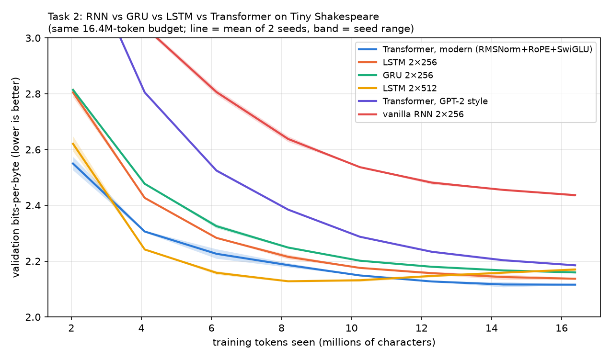
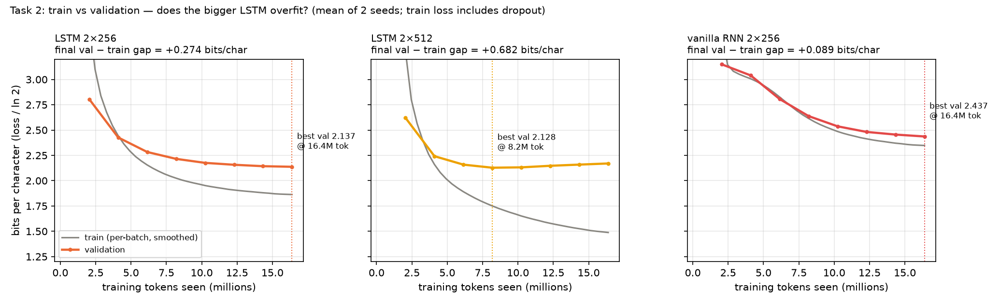
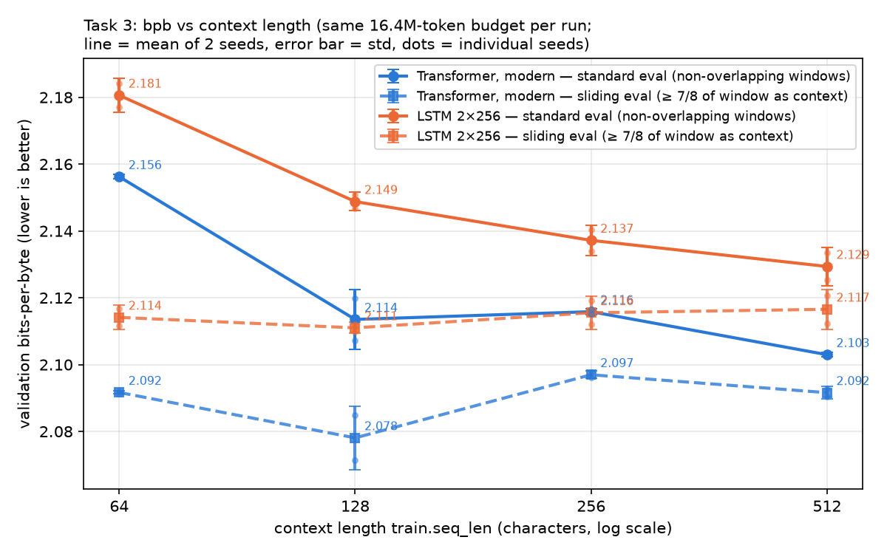
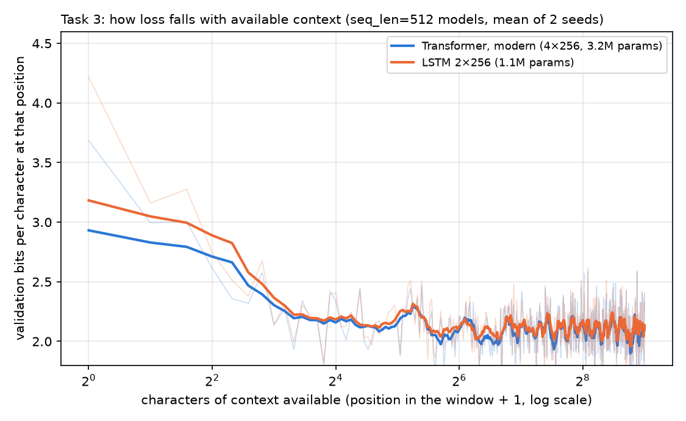
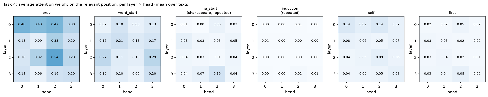
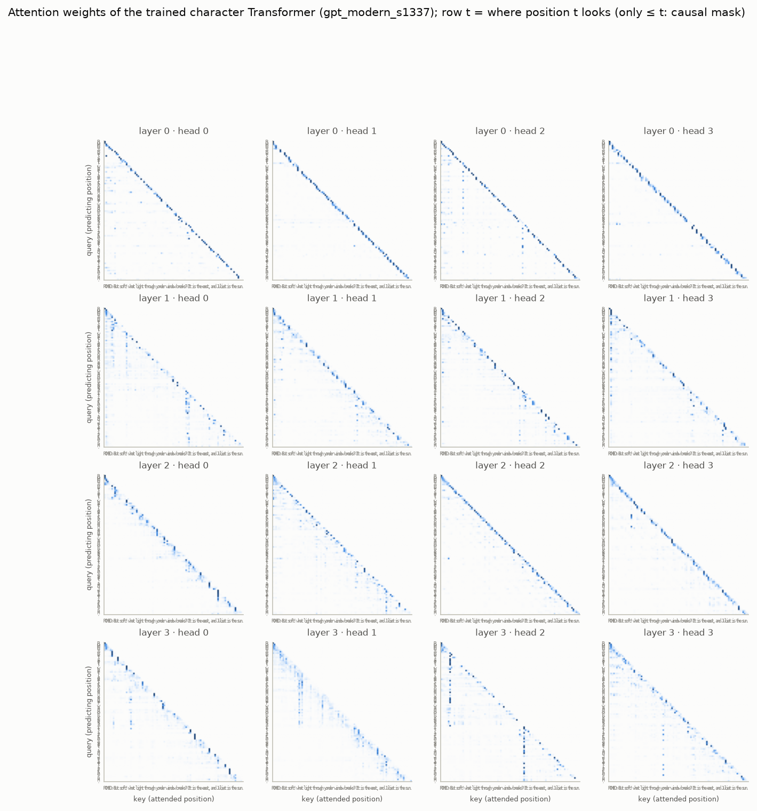
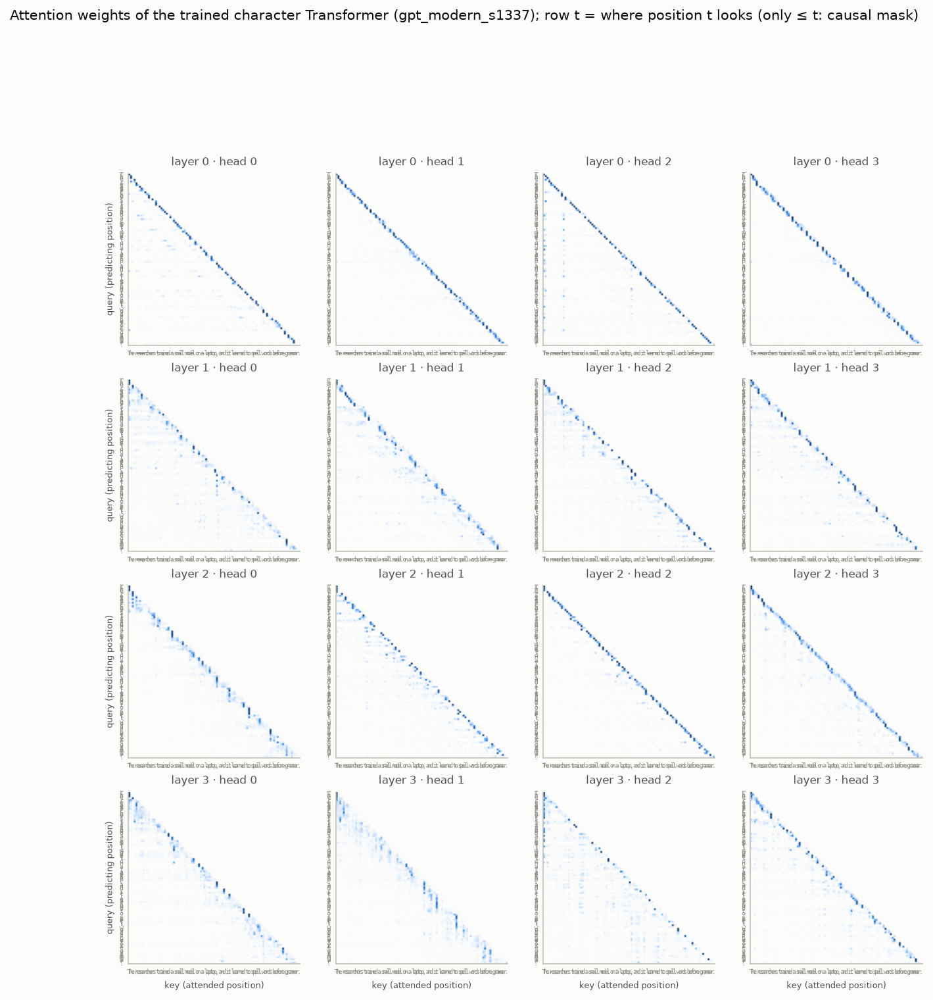
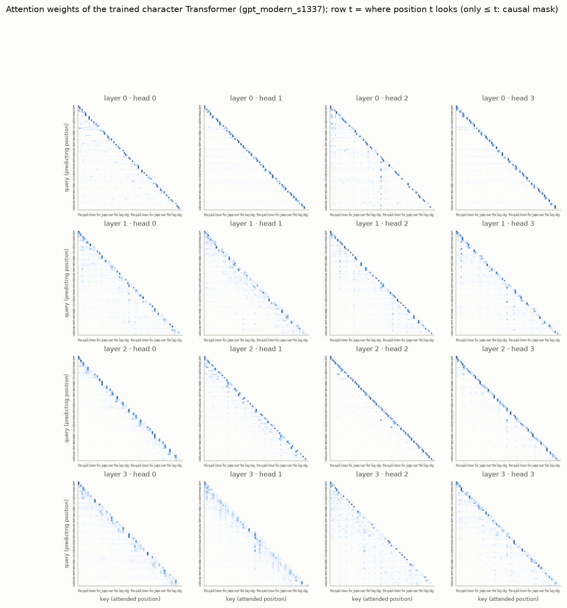

# HW 1: Language Models from Scratch (Part 1)

**Anurag Bodapally** · anurag.bodapally@sjsu.edu · Code, configs, results and figures: https://github.com/Anuragbo/nanolm

## Setup (common to all tasks)

| | |
|---|---|
| Code | `nanolm` from `lkk688/DeepDataMiningLearning`, git commit `8418fc1`. No library code was edited; every experiment is a config/sweep file or a command-line override. |
| Data | Tiny Shakespeare (1.0M training / 111.5K validation characters), character tokenizer (V = 65) unless stated otherwise |
| Device | Apple M4 Pro (24 GB), PyTorch 2.15.0 on MPS, fp32 |
| Budget | Every trained model: 2,000 steps × 8,192 tokens/step = **16.4M training tokens** (about 16 passes over the corpus). Compute ≈ 6ND = 0.03–0.42 PFLOP per run. |
| Seeds | 1337 and 42 for every configuration (the same seeds across models, so the tests are paired) |
| Metric | Validation bits-per-byte (bpb) on the full validation split. Statistics are mean ± std and paired t-test p-values from `nanolm.analyze`. |
| Wall clock | Task 1: about 2 min · Task 2: 34.9 min (12 runs) · Task 3: 35.6 min (16 runs) + 2 min re-evaluation · Task 4 and extra credit: about 1 min |

**Seed noise floor:** the median within-configuration std was **0.003–0.004 bpb**. Following the course rule, I call a difference smaller than about 0.007 bpb "not resolved".

---

## Task 1: Metrics by hand

**Question.** Do the logged metrics follow from their definitions, and does an untrained model score ln V?
**Hypothesis.** ppl = e^loss, bpb = loss · N_tok / (N_bytes · ln 2), and a random model predicts roughly uniformly, so its loss ≈ ln V.

**Trained model:** a 2-layer LSTM with 1.07M parameters (`laptop/L1_char_lstm`). From `metrics.json`: `val_loss` = 1.493252 nats/token, `val_tokens` = `val_bytes` = 111,488.

| quantity | formula | by hand | logged |
|---|---|---:|---:|
| loss | mean −ln p(x_t \| x_<t) | 1.493252 nats/token | 1.493252 |
| perplexity | e^loss | 4.451548 | 4.451548 |
| bits/token | loss / ln 2 | 2.154307 | – |
| bits-per-byte | loss · 111,488 / (111,488 · ln 2) | **2.154307** | 2.154307 |

All values agree to 6 decimal places. Bits/token equals bpb here only because one character is one byte. The model codes the validation text in 240,179 bits instead of 891,904, which is a **3.7× compression**.

**Untrained models** (the same LSTM; "init" = learning rate 0, so the weights stay at their random initialization):

| tokenizer | V | ln V | val loss (init) | loss − ln V | ppl | bytes/token | bpb |
|---|---:|---:|---:|---:|---:|---:|---:|
| char | 65 | 4.174 | 4.197 | +0.023 | 66.5 | 1.00 | 6.055 |
| GPT-2 BPE | 50,257 | 10.825 | 10.823 | −0.002 | 50,173 | 3.09 | 5.049 |

**Analysis.**
- Both losses are within 0.6% of ln V, and both perplexities are about V. A random model is effectively a uniform guess over its vocabulary.
- The two tokenizers differ by 2.6× in loss and by 750× in perplexity, but only by 1.2× in bpb, because one GPT-2 token covers 3.09 bytes. Only bpb compares models with different tokenizers fairly.
- With the assignment's `train.max_steps=1`, the result depends on the learning-rate warm-up:
  - With the normal warm-up, the first step is tiny, and the loss stays at ln V (4.179 for char, 10.804 for GPT-2).
  - With warm-up disabled, a single AdamW step already drops the char loss to **3.592**, below ln V. Accuracy jumps to 14.9%, which is the frequency of the space character: one step is enough to learn the unigram distribution.

  So "untrained" should be measured at initialization.

---

## Task 2: RNN vs LSTM vs GRU vs Transformer

**Hypothesis.** The vanilla RNN is worst because of vanishing gradients. Gated RNNs close most of the gap. The Transformer is best.

**Setup.** The course sweep `sweeps/01_char_models.yaml`, unchanged: 6 models × 2 seeds, all with the same 16.4M-token budget and `seq_len` = 256.

| model | params | val bpb (mean ± std) | Δ vs GPT-2-style (p) | best val bpb (tokens) | train time |
|---|---:|---:|---:|---:|---:|
| **Transformer, modern** (RMSNorm + RoPE + SwiGLU, 4×256) | 3.16M | **2.116 ± 0.001** | −0.069 (p = 0.004) | 2.116 (16.4M) | 190 s |
| LSTM 2×256 | 1.07M | 2.137 ± 0.005 | −0.048 (p = 0.06) | 2.137 (16.4M) | 68 s |
| GRU 2×256 | 0.81M | 2.160 ± 0.002 | −0.026 (p = 0.005) | 2.160 (16.4M) | 277 s |
| LSTM 2×512 | 4.24M | 2.170 ± 0.008 | −0.015 (p = 0.19) | **2.128 (8.2M)** | 154 s |
| Transformer, GPT-2 style (LayerNorm + learned pos. + GELU) | 3.44M | 2.185 ± 0.002 | 0 | 2.185 (16.4M) | 140 s |
| vanilla RNN 2×256 | 0.28M | 2.437 ± 0.006 | +0.252 (p = 0.009) | 2.437 (16.4M) | 165 s |

**Analysis.**
- **The ranking.** Modern Transformer < LSTM < GRU < LSTM-512 < GPT-2-style Transformer ≪ RNN. Every number is within 0.012 bpb of the tutorial's H100 reference.
- **The recipe matters as much as the architecture.** The GPT-2-style Transformer loses to a 3× smaller LSTM. The same Transformer with RMSNorm, RoPE and SwiGLU wins.
- **Which gaps are resolved.** The modern Transformer vs the LSTM (0.021) is about 6× the noise floor. LSTM-512 vs GRU (0.010) is borderline.

**Q: Why does the vanilla RNN fall so far behind?**
- **The gap.** It ends 0.25–0.30 bpb behind every gated model, and its curve is still the highest at every checkpoint.
- **It is underfitting, not overfitting.** Its train and validation curves nearly coincide (final gap +0.09 bits/char, against +0.27 for the LSTM). It is not memorizing; it simply cannot fit the data better.
- **The cause is vanishing gradients.** In h_t = tanh(W_x e_t + W_h h_{t−1}), the gradient reaching step t−k is a product of k Jacobians diag(1 − h²)·W_h, so it shrinks exponentially with k. Gradient clipping fixes the opposite problem (explosion) but cannot fix this, so the RNN only learns short-range statistics.
- **Gates fix it.** The LSTM's additive cell update c_t = f ⊙ c_{t−1} + i ⊙ g gives a path whose derivative is ≈ 1 when f ≈ 1. The GRU's interpolation h' = (1−z)⊙n + z⊙h does the same. Adding gates removes about 90% of the gap.
- **Size is not the explanation.** The RNN also has the fewest parameters (0.28M). But the GRU, with only 0.81M, is 0.28 bpb better, so most of the gap comes from the gating.

**Q: Is the larger LSTM better or worse, and what in the curves shows why?**
- **Better early, worse at the end.** LSTM 2×512 is the best model of all at 8.2M tokens (2.128 bpb). By the end it is worse than the small LSTM (2.170 vs 2.137).
- **The curves show overfitting.**
  - Its validation curve turns *upward* after 8M tokens while its training loss keeps falling.
  - Its final train/validation gap is **+0.68 bits/char**, 2.5× the small LSTM's +0.27.
  - Its validation *accuracy* is higher than the small LSTM's (56.8% vs 56.1%, mean of 2 seeds) even though its bpb is worse. It predicts the right character slightly more often but is over-confident when wrong. That is the signature of memorization.
- **The cause.** 4.2M parameters trained for about 16 passes over 1 MB of text memorize the training set. Early stopping at the halfway point, or more dropout or data, would make it the best recurrent model.

---

## Task 3: Context length

**Hypothesis.** The Transformer can attend to any earlier position, so it should keep improving with longer context. The LSTM must compress the past into a fixed-size state, so it should saturate early.

**Setup.** My sweep `configs/hw1_context.yaml`: modern Transformer and LSTM 2×256 (the Task 2 settings) at `seq_len` ∈ {64, 128, 256, 512}, 2 seeds each, 16 runs. To keep the budget fixed, tokens/step was held at 8,192 (batch 128/64/32/16), so every run saw 16.4M tokens. The 256 runs reproduce Task 2 (2.116 and 2.137), which is a consistency check.

| seq_len | 64 | 128 | 256 | 512 |
|---|---:|---:|---:|---:|
| Transformer: standard eval | 2.156 ± .001 | 2.114 ± .009 | 2.116 ± .001 | **2.103** ± .001 |
| LSTM: standard eval | 2.181 ± .005 | 2.149 ± .003 | 2.137 ± .005 | **2.129** ± .006 |
| Transformer: sliding eval | 2.092 ± .000 | **2.078** ± .010 | 2.097 ± .001 | 2.092 ± .002 |
| LSTM: sliding eval | 2.114 ± .004 | **2.111** ± .002 | 2.116 ± .005 | 2.117 ± .006 |

**Analysis.**
- **Standard evaluation** (non-overlapping windows) seems to say both models improve with context: the LSTM steadily up to 512, the Transformer mostly from 64 to 128.
- **That reading is confounded by "cold starts".** Every window starts with zero context, so the first characters of each window are predicted almost blind.
  - The per-position curve (second figure) shows loss falling from about 3.1–3.4 bits at positions 1–4 to about 2.1 by position 16–64, and then **staying flat to position 512 for both models**. Position buckets 65–128, 129–256 and 257–512 give 2.07 / 2.10 / 2.09 for the Transformer and 2.10 / 2.12 / 2.11 for the LSTM.
  - A longer window therefore lowers the average mainly because a smaller fraction of its characters are cold: 25% of the positions fall in the first 16 at seq_len = 64, but only 3% at 512.
- **Sliding-window re-evaluation removes the confound.** Each trained model was re-scored, without retraining, with stride = seq_len/8, so every scored character has at least 7/8 of the window as context. The curves become almost flat:
  - The **LSTM gains nothing beyond 64 characters.** All changes are below 0.005, which is within noise.
  - The **Transformer's only resolved gain is 64 → 128** (+0.014). Even that is borderline, because the 128 configuration has the largest seed spread (±0.010). It gains nothing beyond 128.

**Q: Where does each stop benefiting from more context?** The LSTM stops at about **64** characters. The Transformer stops at about **128** characters, or at about 512 if you only look at the standard-eval numbers, which overstate the gain.

**Q: Which architecture uses longer context more effectively?** The **Transformer, but only modestly.**
- It has lower loss at *every* context length and at every position in the window (by 0.02–0.04 bits).
- It is the only model with any measurable gain beyond 64 characters.
- **Neither model gets much out of more than about 100 characters on this corpus.** I believe this is a **genuine negative result, not a bug**:
  1. My per-position code reproduces the logged bpb exactly when averaged over positions (2.1166 = 2.1166).
  2. The 256-context runs reproduce Task 2.
  3. The flat region is the same for both architectures and both seeds.
  4. Character-level Shakespeare is mostly predictable from the current word and line. With 1 MB of data, there is little to learn from 300 characters back. (This is also consistent with the missing induction heads in Task 4.)
- **Limitation.** Holding tokens/step fixed means batch size changed together with seq_len.

---

## Task 4: Attention analysis

**Setup.** I used the Task 2 modern Transformer (`gpt_modern_s1337`: 4 layers × 4 heads, 2.117 bpb) with `python -m nanolm.viz attention` on three kinds of text:
- Shakespeare dialogue (in distribution)
- modern English prose
- a repeated sentence (to test for copying)

Code could not be used: the 65-character vocabulary has no digits, brackets or `=`.

For each head, `scripts/task4_heads.py` reuses `nanolm.viz.attention_maps` and computes the **average attention weight on the relevant key**, averaged over all applicable query positions. It compares this with uniform attention, mean 1/(t+1), which is about 0.04–0.05 here. All attention rows were checked to sum to 1.

| head type | head | Shakespeare | modern prose | repeated | uniform | evidence |
|---|---|---:|---:|---:|---:|---|
| **Previous-token** (key t−1) | L2·H2; all of layer 0 | **0.48** | **0.56** | **0.58** | 0.04–0.05 | ≈ 10–14× uniform. Layer 0 heads score 0.30–0.57 on every text: a learned bigram detector. |
| **Word-start** (first letter of the current word, ≥ 2 back) | L2·H3 (also L2·H0) | **0.30** | 0.21 | **0.35** | 0.04–0.05 | 5–7× uniform. It helps complete the spelling of the current word. |
| **Speaker-line** (last `:`/newline) | L3·H2 | **0.34** | – | 0.03 | 0.03 | 11× uniform on dialogue, but not on `.` in prose. It also has the longest mean look-back of all 16 heads (14.4 characters). |
| Induction (key after the earlier copy) | none | – | – | ≤ 0.02 | 0.02 | No head copies from the first occurrence of the repeated sentence. |

**Analysis.**
- **The model splits its work by layer.** Layer 0 does local character n-gram work. Layer 2 builds word-level structure: previous-token and word-start heads. L3·H2 tracks the play's format: who is speaking and where the line began.
- **These are the same specializations the tutorial reports for its reference model** (§1.6.2: layer-0 previous-token heads, L2·H3/L3·H3 word-start, L3·H2 speaker line). An independently trained model rediscovered them, which suggests they are robust features of this task, not accidents of one seed.
- **No induction head.** This 4-layer model trained on 16M characters never learned to copy repeated text. That agrees with Task 3: on this data, long-range copying rarely pays off.

The full 16-head maps for the three texts, and the per-head tables, are in the appendix and `results/task4_heads.md`.

---

## Conclusion and limitations

1. **bpb is the metric to trust.** It matches its definition exactly, and it ranks models across tokenizers correctly. An untrained model scores ln V per token.
2. **Gates are what make recurrent models work.** The vanilla RNN underfits by 0.25+ bpb because of vanishing gradients. The GRU and LSTM fix this.
3. **Bigger is not automatically better.** LSTM-512 is the best model halfway through and then overfits 1 MB of text (train/val gap 0.68 bits).
4. **The modern Transformer is the best model**, but its recipe matters: the GPT-2-style version loses to a small LSTM.
5. **Both models stop benefiting from context early** (about 64 characters for the LSTM, about 128 for the Transformer) once the evaluation cold-start artifact is removed. The Transformer uses context slightly better at every length.

**Extra credit** (Appendix D): a gate-by-gate GRU matches `nn.GRU` to 1e-15 (float64), including gradients and a 30-step training run.

**Limitations.**
- Only 2 seeds, so differences around 0.01 bpb remain borderline.
- One small corpus.
- Batch size covaries with seq_len in Task 3.
- MPS training is not bit-deterministic (about ±0.005 bpb between reruns).
- Different learning rates per architecture (the course defaults) mean some ranking differences may partly reflect tuning.

---

## Appendix

**A. Reproduction.** Every command is in `README.md`. Configs: `configs/01_char_models.yaml` (course, unchanged) and `configs/hw1_context.yaml` (mine). Task 1 used command-line overrides of `laptop/L1_char_lstm.yaml`, listed in `README.md`. Statistics: `results/task{2,3}_analyze/summary.{csv,md}`.

**B. Generated samples** (temperature 0.8, top-k 50, seed 1337) show the gap from Task 2 qualitatively.
- Modern Transformer: *"CORIOLANUS: / The England's life and thousand son, and with him, / Which are then should before the life:"*
- Vanilla RNN: *"Carllon the enem? I do not nate and / bonted tell thee with in with this basting himself"*

**C. Full attention maps** of `gpt_modern_s1337`. Row t = where position t looks; the causal mask leaves the upper triangle empty.

**D. Extra credit: a GRU written gate by gate.**

`scripts/gru_scratch.py` implements `GRUScratch` in the style of `LSTMScratch`:
- r = σ(W_ir x + b_ir + W_hr h + b_hr)
- z = σ(W_iz x + b_iz + W_hz h + b_hz)
- n = tanh(W_in x + b_in + r ⊙ (W_hn h + b_hn))
- h' = (1−z) ⊙ n + z ⊙ h

The one subtlety is that r multiplies the hidden projection **including its bias b_hn**. That is why the input and hidden projections are kept as separate `Linear` layers.

I copied the weights from a 2-layer `nn.GRU` (input 64, hidden 128, batch 8, 50 steps) and compared:

| test | max relative difference | result |
|---|---:|---|
| CPU float64: outputs, final hidden state, input gradient, all weight gradients | ≤ 1.4e-15 | PASS |
| CPU float32 | ≤ 7.7e-7 | PASS |
| MPS float32 | ≤ 3.0e-7 | PASS |
| End to end: two char LMs trained for 30 AdamW steps on Tiny Shakespeare from the same init (float64) | loss gap 8.9e-16 | PASS |

The losses agree to 12 decimal places at every step. The step-1 loss is 4.1747 ≈ ln 65, which is Task 1's untrained-model check again.

One methodological note: a first check with an *absolute* 1e-5 tolerance "failed" for the float32 weight gradients (1.2e-5). These gradients are sums of 400 terms, and fp32 has about 7 significant digits, so the right test is the relative error, which is 7.7e-7. Both numbers are reported in `results/gru_check.txt`.
